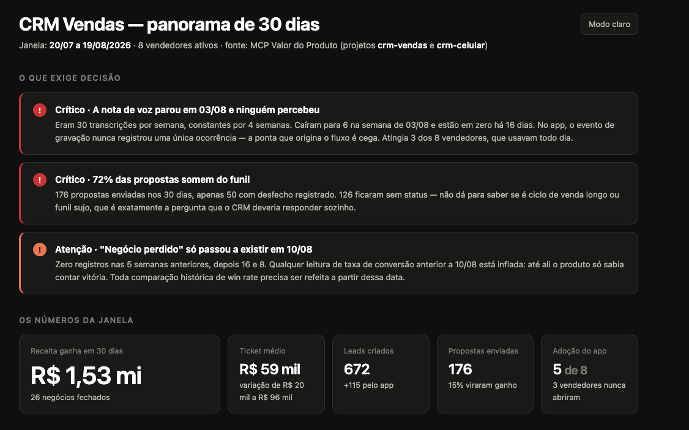
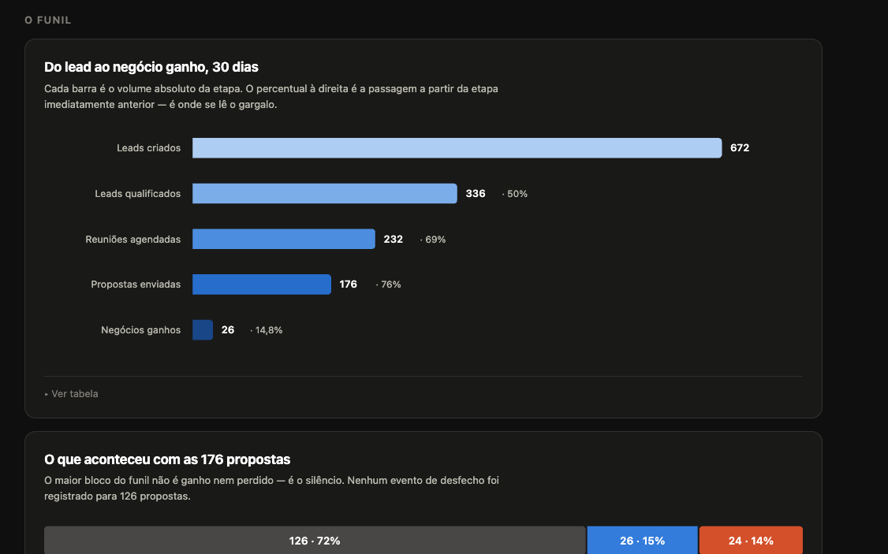

# Visão de Produto

Plataforma de product analytics deliberadamente pequena: os aplicativos enviam os eventos que importam por uma API REST, e as respostas ficam disponíveis num site com painéis e num servidor MCP pelo qual o Claude responde as mesmas perguntas em linguagem natural.

**Site:** [visaodeproduto.com.br](https://visaodeproduto.com.br/)





## Principais funcionalidades

- **Nada é capturado automaticamente:** sem IP, sem geolocalização, sem pageview implícito. Só entra o evento que o app envia.
- **Todo evento carrega uma descrição em português**, tratada como campo de primeira classe.
- **O evento que não ocorreu aparece**, com zero explícito, na tela de uso.
- Ingestão REST autenticada por chave de projeto, em lotes de até 100 eventos, com deduplicação pelo `id` do evento.
- Site com login Google, projetos, atividade ao vivo, uso por evento, painel, pessoas, catálogo de eventos e exportação CSV dos próprios dados.
- Servidor MCP remoto, somente leitura, para o Claude consultar os dados.
- SDK JavaScript/TypeScript único (`@dablab/visao`) para web, React Native/Expo e Node, e a CLI `npx visao init`, que cria o projeto, gera a chave e instala o SDK.
- Duas skills para agentes: uma de instrumentação (adiciona as chamadas no código) e uma de leitura (responde sobre uso).
- Plano pago com assinatura via Stripe.

## Stack técnica

- **Monorepo** com pnpm workspaces, TypeScript em todos os pacotes.
- **Site:** Next.js 16 (App Router), React 19 — em [`apps/web`](apps/web).
- **Banco e autenticação:** Supabase (Postgres com tabela de eventos particionada por data, Row Level Security, Auth com Google).
- **Ingestão e MCP:** Supabase Edge Functions (Deno) — em [`supabase/functions`](supabase/functions).
- **SDK e CLI:** [`packages/sdk-js`](packages/sdk-js) e [`packages/cli`](packages/cli).
- **Cobrança:** Stripe (checkout e webhook).
- **Deploy:** Vercel.
- **Testes:** Vitest.

## Como foi construído

A Visão de Produto foi desenvolvida com Claude (Anthropic) a partir de uma especificação no formato SDD:

- [`spec.md`](spec.md) — o documento-fonte; é ele que decide.
- [`CLAUDE.md`](CLAUDE.md) — como trabalhar no repositório sem quebrar o que já está de pé.
- [`DOCUMENTACAO-TECNICA.md`](DOCUMENTACAO-TECNICA.md) — como o sistema ficou.
- [`modelo-visao-de-produto.dbml`](modelo-visao-de-produto.dbml) e [`schema.sql`](schema.sql) — o modelo de dados e o retrato do banco.
- [`EPICO-COBRANCA.md`](EPICO-COBRANCA.md) — o desenho da cobrança.

Guardrails que existem no repositório: uma suíte Vitest em [`tests/`](tests/) que roda contra um banco Supabase de desenvolvimento real (regras de negócio, RLS e partições, servidor MCP, webhook da Stripe), migrations SQL versionadas em [`supabase/migrations/`](supabase/migrations) como fonte de verdade do esquema, além de lint (ESLint) e checagem de tipos.

## Status

Publicado — no ar em [visaodeproduto.com.br](https://visaodeproduto.com.br/).

## Rodar localmente

Precisa de **Node 22+** e **pnpm**. Não precisa de Docker nem de Postgres local: o banco é um projeto Supabase na nuvem, e a CLI do Supabase é dependência do repositório.

```bash
pnpm install
cp .env.example .env    # e preencha com os dados do seu projeto Supabase
pnpm dev                # http://localhost:3000
```

O [`.env.example`](.env.example) lista todas as variáveis, com o caminho de onde tirar cada valor.

```bash
pnpm typecheck    # TypeScript em todos os pacotes
pnpm lint
pnpm test         # Vitest — os testes de integração exigem um projeto Supabase de dev
pnpm build
```

### Estrutura

```
apps/web                     Next.js 16 (App Router) — o site
packages/sdk-js              @dablab/visao — SDK web / React Native / Node
packages/cli                 npx visao init
supabase/migrations          SQL versionado
supabase/functions/ingest    Edge Function de ingestão
supabase/functions/mcp       Edge Function do servidor MCP
skills/                      skills de instrumentação e de leitura
tests/                       suíte de testes
scripts/                     utilitários de manutenção
site-visao-de-produto/       página pública do produto
```

Convenção de idioma: **banco em português**, `snake_case`; **código em inglês**. Todo comentário é em português.

### Instrumentar um aplicativo

Pelo SDK:

```ts
import { init, identify, track } from "@dablab/visao";

init({ key: process.env.VISAO_API_KEY, projeto: "meu-app" });
identify("pessoa@exemplo.com");

track("app_algo_aconteceu", {
  descricao: "usuário fez a coisa que você quer medir",
  tela: "NomeDaTela",
  props: { valor: 250 },
});
```

Ou direto pela API REST, que é o contrato estável:

```bash
curl -X POST "$VISAO_HOST/functions/v1/ingest" \
  -H "content-type: application/json" \
  -H "x-api-key: $VISAO_API_KEY" \
  -d '{"eventos":[{"id":"<uuid>","nome":"app_algo_aconteceu","distinct_id":"pessoa@exemplo.com","ocorrido_em":"2026-08-17T12:00:00Z","descricao":"usuário fez a coisa que você quer medir"}]}'
```

O `id` é de quem envia e protege contra duplicata: reenviar o mesmo evento nunca conta duas vezes.

### Ligar o Claude

Pelo aplicativo do Claude, adicione um conector personalizado apontando para o servidor MCP. Por arquivo de configuração, gere um token de leitura na tela **Conta → Credenciais MCP** e cole o bloco no cliente. O passo a passo está na própria plataforma, em **Conta → Como usar**. O acesso do Claude é somente leitura.

## Licença

O código está disponível apenas para leitura e estudo. Veja [LICENSE](LICENSE).

## Contribuições

Issues são bem-vindas; pull requests não são aceitos. Veja [CONTRIBUTING.md](CONTRIBUTING.md).

---

Feito pela [Dab Lab](https://www.dablab.com.br/) — product studio de software e IA que constrói apps para pequenas empresas, startups e áreas dentro de grandes empresas, partindo de uma especificação (Spec-Driven Development) e com as disciplinas de engenharia de software robusta.
