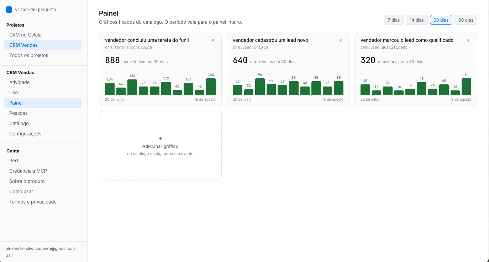
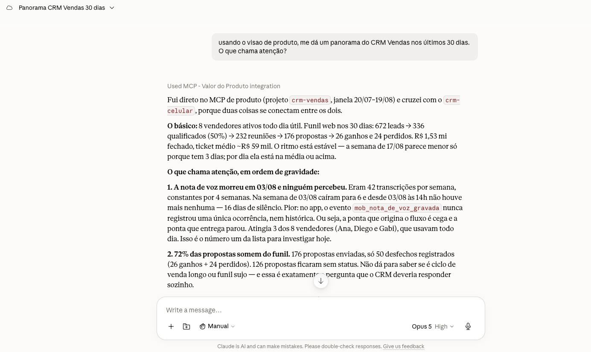
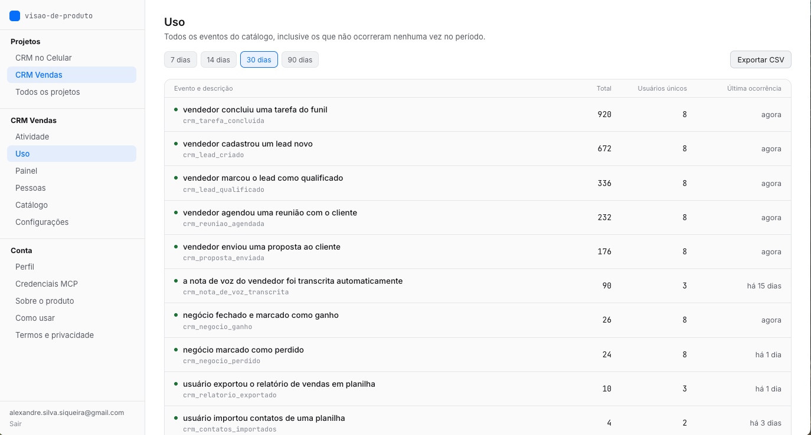
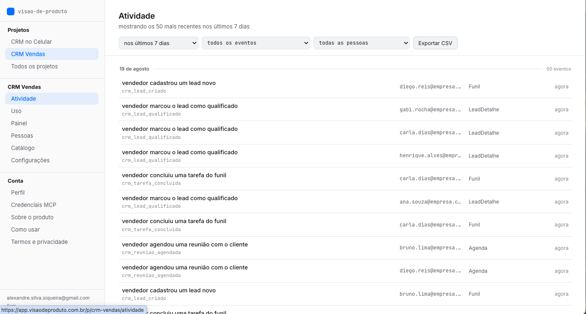

# Visão de Produto

<p align="center">
  
  &nbsp;
  
</p>

<p align="center">
  <a href="https://visaodeproduto.com.br"><b>visaodeproduto.com.br</b></a> ·
  <a href="https://app.visaodeproduto.com.br">Entrar</a> ·
  <a href="https://app.visaodeproduto.com.br/termos">Termos e privacidade</a>
</p>

O **Visão de Produto** é uma plataforma de product analytics deliberadamente pequena, em
português, para quem constrói aplicativo com o Claude, o Lovable e afins. O seu app manda um
evento a cada ação que você escolheu acompanhar, e a resposta fica disponível de duas formas
equivalentes: o painel, no navegador, e um servidor MCP, pelo qual o Claude responde as mesmas
perguntas em linguagem natural.

Três decisões o definem, e é melhor saber delas antes de experimentar:

- **Nada é capturado sozinho.** Sem IP, sem geolocalização, sem pageview implícito, sem tela
  gravada. Só existe aqui o evento que você declarou, um a um.
- **Todo evento carrega o que significa.** A descrição em português é campo de primeira classe,
  não propriedade solta. Você lê "vendedor cadastrou um lead novo", e não `crm_lead_criado`.
- **O evento que não ocorreu aparece**, com o zero escrito na tela. Costuma ser a informação
  mais útil: a funcionalidade que você subiu semana passada e ninguém abriu.

É um produto da [Dab Lab](https://www.dablab.com.br/).

## Só entra o que você declarou

A tela de **Uso** lista todo evento do catálogo no período, inclusive os que não ocorreram
nenhuma vez. Cada linha traz a descrição em português, o total, quantas pessoas distintas e
quando foi a última ocorrência.

<p align="center">
  
</p>

O catálogo é o dicionário do produto: nome técnico, descrição e as telas em que o evento
aparece. É ele que o Claude lê antes de responder — por isso a descrição importa tanto quanto
o dado. Editar a descrição no catálogo manda em tudo: ela passa a valer nas telas e nas
respostas do assistente.

## Headless: pelo Claude e por outros assistentes com MCP

O Visão de Produto responde sem você abrir o site. O servidor MCP conecta a sua conta ao Claude
— claude.ai, Claude Desktop, Claude Code — e a qualquer cliente compatível, por OAuth ou por um
token de leitura. Pergunte em português, do jeito que você falaria:

<p align="center">
  
</p>

São cinco ferramentas: `atividade_recente`, `uso_por_evento`, `pessoa`, `catalogo` e `consulta`
— esta última um `select` somente leitura, limitado a quatro tabelas e a 500 linhas. Você não
precisa lembrar o nome de nenhum evento: o assistente lê o catálogo sozinho e entende o que cada
um significa pela descrição.

O acesso é **somente leitura**, garantido pela permissão do papel no banco e não apenas por
validação de texto. O que a tela responde, o MCP responde — é um princípio do projeto, não um
extra.

## As telas

**Atividade** mostra o que acabou de chegar, em ordem, com a descrição, quem fez e em que tela.

<p align="center">
  
</p>

Além dessas, cada produto tem **Painel** (os gráficos que você fixou do catálogo), **Pessoas**
(o histórico de cada identificador), **Catálogo** e **Configurações**, onde ficam a chave de
ingestão, o prefixo dos nomes de evento e o fuso de exibição.

## O que ele não é

Quatro coisas que outra ferramenta faz melhor, e que este produto não tenta fazer:

- **Medir acesso de site.** Não conta visitantes, origem nem campanha.
- **Montar funil.** O produto não calcula etapas; o Claude monta, quando você pede.
- **Teste A/B.** Não sorteia variante nem calcula significância.
- **Gravar tela.** Não grava clique, rolagem nem movimento de mouse.

## Quanto custa

| | Grátis | Pago |
|---|---|---|
| Preço | R$ 0 | R$ 50 por mês |
| Produtos | 1 | ilimitados |
| Janela de consulta | 1 mês | 12 meses |
| Painel e Claude | os dois | os dois |

Mandar mais evento nunca aumenta a conta: o preço é por produto, não por volume. Acompanhar
tudo o que importa é justamente o que a plataforma quer que você faça.

## Stack técnica

- **Next.js 16** (App Router) na Vercel — o site e as rotas de servidor.
- **Supabase Postgres 17** em `sa-east-1` — RLS com predicado de propriedade em toda tabela, e
  `eventos` particionada por semana via `pg_partman`.
- **Edge Functions (Deno)** — `ingest`, que grava, e `mcp`, que lê.
- **Stripe** para a assinatura, **Bird** para os e-mails da conta.
- `api.visaodeproduto.com.br` é a porta pública das duas Edge Functions, servida por um proxy
  na Vercel. Nenhum app instrumentado precisa saber o endereço do banco — e foi isso que
  permitiu desligar o Custom Domain do Supabase sem ninguém publicar versão nova.

## Como foi construído

Com o Claude (Anthropic), a partir de uma especificação SDD: [`spec.md`](spec.md), que é a fonte
de verdade e decide qualquer divergência. O trabalho foi por épicos, cada um verificado contra
a spec antes do commit. As convenções e as armadilhas que custaram tempo estão em
[`CLAUDE.md`](CLAUDE.md) — vale ler antes de mexer.

| Documento | Para quê |
|---|---|
| [`spec.md`](spec.md) | A especificação. É ela que decide, sempre |
| [`DOCUMENTACAO-TECNICA.md`](DOCUMENTACAO-TECNICA.md) | Como o sistema ficou de fato |
| [`CLAUDE.md`](CLAUDE.md) | Como trabalhar neste repositório |
| [`EPICO-COBRANCA.md`](EPICO-COBRANCA.md) | O desenho da cobrança |
| [`schema.sql`](schema.sql) | Retrato do banco de produção, gerado dele |

---

# Rodar e publicar

## Antes de começar

Precisa de **Node 22+** e **pnpm**. Não precisa de Docker, nem de Postgres local, nem da CLI do
Supabase instalada globalmente — o banco é na nuvem e a CLI é dependência do repositório.

```bash
git clone git@github.com:asiqueira1973/visao-de-produto.git
cd visao-de-produto
pnpm install
cp .env.example .env    # e preencha, conforme a seção abaixo
pnpm dev                # http://localhost:3000
```

A branch de trabalho é **`dev`**; `main` é produção.

## Variáveis de ambiente

Todas vivem no `.env` da raiz, que está no `.gitignore` e **nunca** vai para o git. O
[`.env.example`](.env.example) lista todas, com o caminho de onde tirar cada valor.

| Variável | O que é | Onde encontrar |
|---|---|---|
| `NEXT_PUBLIC_SUPABASE_URL` | Endereço do projeto | Supabase → Project Settings → API |
| `NEXT_PUBLIC_SUPABASE_ANON_KEY` | Chave pública | idem |
| `SUPABASE_SERVICE_ROLE_KEY` | **Secreta.** Só em rota de servidor e Edge Function | idem |
| `SUPABASE_ACCESS_TOKEN` | Token pessoal, para a CLI publicar função e definir segredo | supabase.com/dashboard/account/tokens |
| `STRIPE_SECRET_KEY` | Chave da assinatura | Stripe → Developers → API keys |
| `STRIPE_PRICE_ID` | O preço de R$ 50/mês | Stripe → Product catalog |
| `STRIPE_WEBHOOK_SECRET` | Assinatura do webhook | Stripe → Developers → Webhooks |
| `VISAO_API_KEY` | Chave de ingestão de um app instrumentado | Configurações do produto |
| `VISAO_HOST` | Base da ingestão | `https://api.visaodeproduto.com.br` |

`NEXT_PUBLIC_SITE_URL` existe só nos ambientes publicados e diz qual é o endereço público
daquele deploy. Localmente ela fica vazia e o código cai para `http://localhost:3000`.

**A regra dura:** nenhuma chave, token, senha ou string de conexão real entra em arquivo
versionado. Nem em README, nem em comentário, nem em mensagem de commit.

## Ambiente

Hoje existe **um único banco**, o de produção (`glohvqzopiffdghwppor`, `sa-east-1`). O projeto
de dev foi descontinuado em novembro de 2026. A consequência prática é que a suíte de
integração de [`tests/`](tests) não tem onde rodar e falha com `fetch failed` — isso não é
regressão, é o ambiente que deixou de existir. O que roda e vale é `pnpm typecheck`,
`pnpm lint` e os testes unitários de `packages/cli` e `packages/sdk-js`.

Para saber com qual banco um deploy está falando, sem entrar nele:

```bash
curl https://<endereco-do-deploy>/api/saude
```

## Migrations

O SQL versionado fica em [`supabase/migrations/`](supabase/migrations), em ordem cronológica.
São a **fonte de verdade do esquema** — o banco é o resultado delas, nunca o contrário.

O histórico local está dessincronizado do remoto, porque várias migrations antigas foram
aplicadas por outro caminho e ganharam outro carimbo. Por isso **`supabase db push` não serve
aqui**: ele tentaria reaplicar migration já aplicada. Aplique a sua sozinha e registre a versão
em `supabase_migrations.schema_migrations` no mesmo envio.

Rode `get_advisors` (segurança **e** performance) depois de toda DDL, e regenere o retrato do
banco:

```bash
./scripts/gerar-schema.sh
```

## Comandos

```bash
pnpm dev          # site em desenvolvimento
pnpm typecheck    # TypeScript em todos os pacotes
pnpm lint
pnpm test         # Vitest
pnpm build
```

## Publicar

Três superfícies, três caminhos, e **nenhum é automático**:

| O que | Como |
|---|---|
| App (`app.visaodeproduto.com.br`) | merge `dev` → `main` e push. O push **não** promove: o deployment fica como preview até alguém promover na Vercel |
| Site (`visaodeproduto.com.br`) | `vercel --prod --yes --scope <time>`, de dentro de `site-visao-de-produto/publico/` |
| Edge Functions | `supabase functions deploy <nome> --project-ref <ref> --no-verify-jwt` — a flag **não** é opcional: `ingest` e `mcp` autenticam sozinhas, e sem ela as duas param |

## Estrutura

```
apps/web                     Next.js 16 (App Router) — o site
packages/sdk-js              SDK web / React Native / Node (ainda não publicado no npm)
packages/cli                 a CLI de instrumentação
supabase/migrations          SQL versionado
supabase/functions/ingest    Edge Function de ingestão
supabase/functions/mcp       Edge Function do servidor MCP
site-visao-de-produto        o site institucional, publicado à parte
proxy-api                    o proxy de api.visaodeproduto.com.br
skills/                      skills de instrumentação e de leitura
tests/                       suíte de integração
scripts/                     utilitários de manutenção
```

Convenção de idioma: **banco em português**, `snake_case`; **código em inglês**. A fronteira
fica na camada de acesso a dados — os tipos que espelham o banco mantêm os nomes em português.
Todo comentário é em português, e todo cabeçalho de função diz o que ela faz, o que recebe, o
que devolve e qual regra do spec implementa.

Uma divergência proposital: na interface a entidade se chama **Produto**, mas no banco e no
código ela continua sendo `projeto`. A renomeação de novembro de 2026 trocou só o texto lido
por gente; renomear tabela e coluna num banco com app publicado nas lojas não valia o risco.

## Instrumentar um aplicativo

O contrato estável é o REST, e não exige instalar nada:

```bash
curl -X POST "https://api.visaodeproduto.com.br/functions/v1/ingest" \
  -H "content-type: application/json" \
  -H "x-api-key: $VISAO_API_KEY" \
  -d '{"eventos":[{"id":"<uuid>","nome":"app_algo_aconteceu","distinct_id":"pessoa@exemplo.com","ocorrido_em":"2026-08-17T12:00:00Z","descricao":"usuário fez a coisa que você quer medir"}]}'
```

Até 100 eventos por chamada. O `id` é seu e é a proteção contra duplicata: reenviar o mesmo
evento nunca conta duas vezes. Evento inválido volta em `rejeitados` com o motivo, e os outros
entram.

Existe um SDK em [`packages/sdk-js`](packages/sdk-js), que cuida de fila, lote e reenvio, mas
ele **ainda não está publicado no npm** — por enquanto, a chamada HTTP acima é o caminho.

## Contribuições

Issues são bem-vindas: bugs, dúvidas e sugestões. Pull requests não são aceitos. Veja
[CONTRIBUTING.md](CONTRIBUTING.md).

## Licença

O código está aberto para leitura e estudo, nos termos do [LICENSE](LICENSE).

Feito pela [Dab Lab](https://www.dablab.com.br/), product studio de software e IA que constrói
apps para pequenas empresas, startups e áreas dentro de grandes empresas, partindo de uma
especificação (Spec-Driven Development) e com as disciplinas de engenharia de software robusta.
